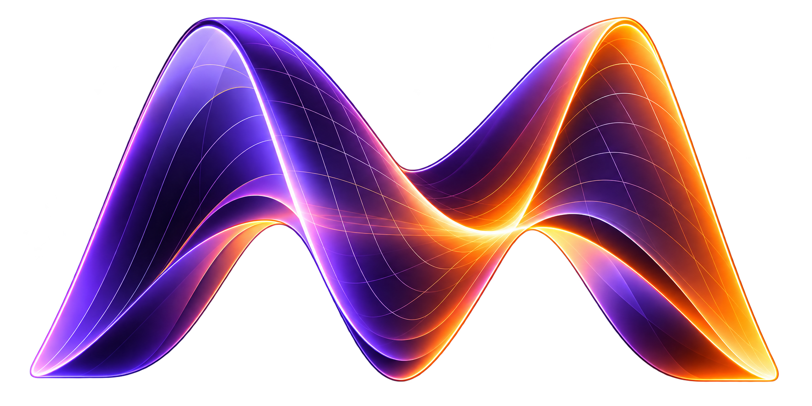
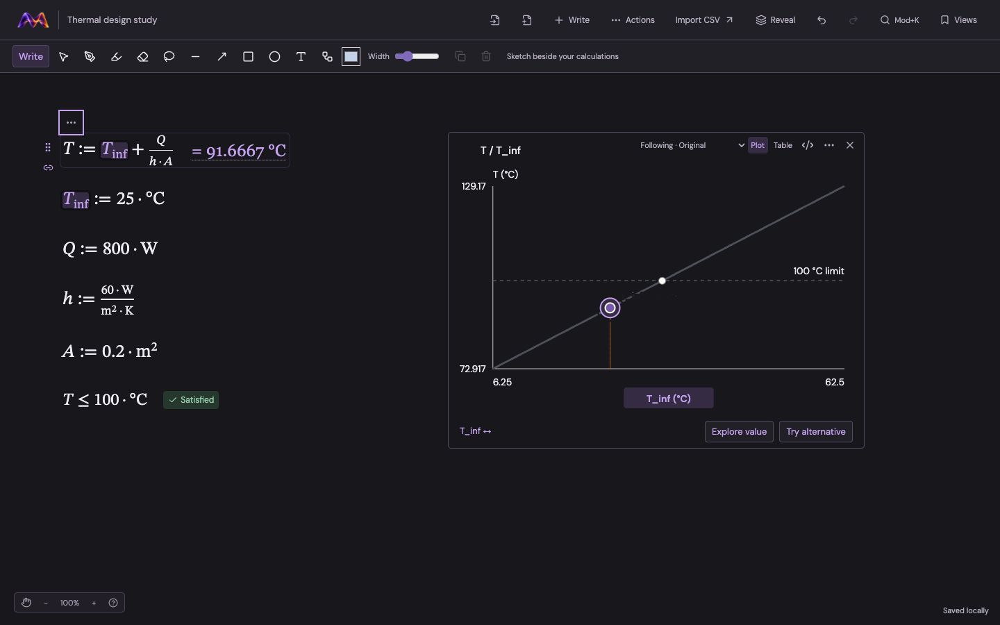
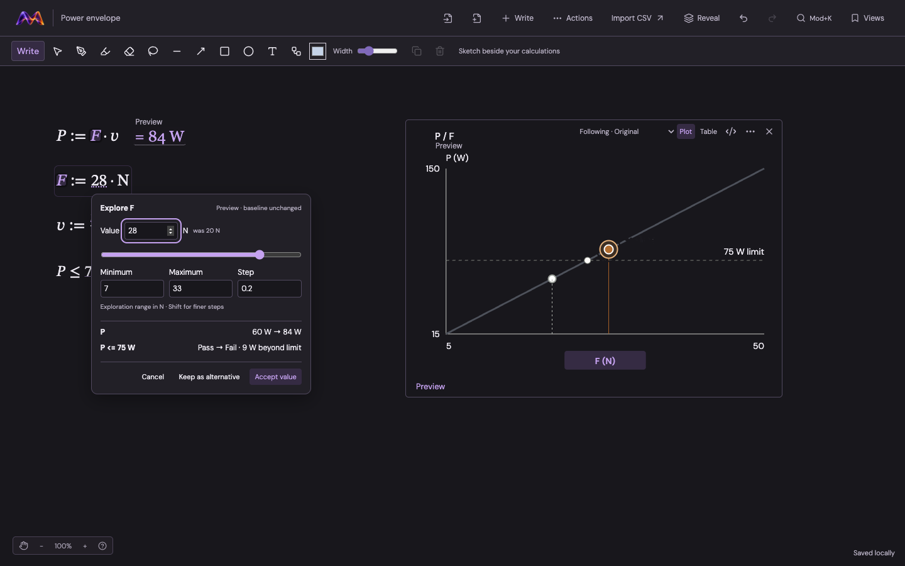
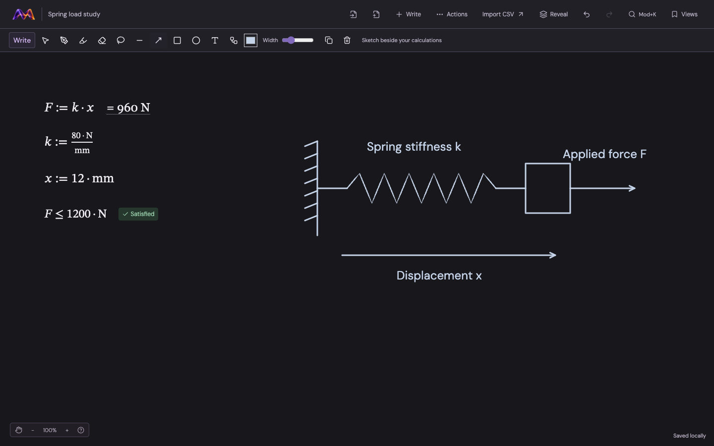
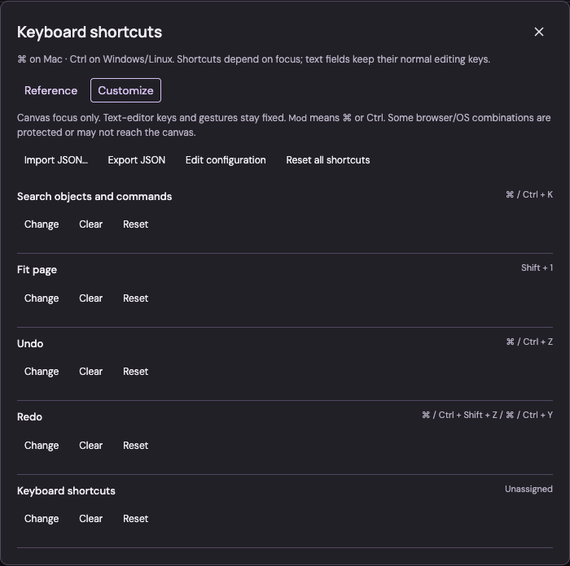

<p align="center">
  
</p>

<h1 align="center">Manifold</h1>
<p align="center"><strong>A bicycle for the engineering mind.</strong></p>
<p align="center">Create · Connect · Explore</p>

Manifold is an open-source engineering canvas for equations, measurements, sketches
and computational results. Think spatially, connect your work and explore alternatives
without losing the original.



## Work with the problem, not the interface

- **Write naturally.** Place equations and notes anywhere. Units-aware results appear
  beside your work; a quiet, content-sized editor keeps the canvas out of the way.
- **Connect and inspect.** Import CSV measurements, trace mathematical relationships
  and put plots and tables alongside the definitions that produced them.
- **Explore safely.** Vary an input, see downstream effects and constraint crossings,
  then cancel, accept the value or keep an alternative.
- **Sketch your reasoning.** Use pressure-sensitive ink, highlighter, shapes, labels
  and attached visual connectors. Sketches never silently become mathematical dependencies.
- **Keep control.** Undo/Redo, deliberate docking previews, overlap selection and
  searchable, customizable shortcuts support different ways of working.
- **Keep your work.** Save locally in your browser and export portable workspace files.
  Local browser storage is device-specific; export a file for backup or handoff.

**Early prototype.** These are implemented interactions, not a claim of validated
engineering practice or demonstrated usability. No live AI service is connected.

## A closer look

### Explore an input before changing your baseline

Preview the consequences, including whether a constraint still holds. Keep a useful
alternative or return to the original.



### Put diagrams beside the mathematics

Sketch a load path, annotate assumptions and connect visual elements without changing
the computational model.



### Make the keyboard yours

Search the shortcut reference, record personal canvas bindings, or edit and exchange
their JSON configuration. Editor keys and essential navigation remain protected.



## Run locally

Requires **Python 3.11+**, **Node 22.18+** and npm. Python uses only the standard library.

```sh
make setup
make canvas
```

Open [Manifold locally](http://127.0.0.1:58310/). Click the canvas and start writing,
or import a CSV. **New canvas** opens separate work with its own URL.

Without Make:

```sh
npm ci
npm --prefix apps/canvas run build
python3 apps/canvas/server.py
```

See the [application guide](apps/canvas/README.md) for controls and file handling.

## Develop and contribute

```sh
make check          # Repository, docs, Python, types, unit tests and builds
make verify         # Also runs foundation and canvas browser workflows; needs Chrome
```

For frontend development, leave the Python server running and use `make canvas-dev`.
The reusable, UI-independent foundation and its examples live in
[`packages/foundation`](packages/foundation/README.md); run `make foundation` for its workbench.

- [Contributing](CONTRIBUTING.md)
- [Architecture and extension patterns](docs/design/canvas-extension-patterns.md)
- [Repository map](docs/repository.md)
- [Vision](docs/vision.md) and [interaction design](docs/interaction-design.md)

Manifold is licensed under [Apache-2.0](LICENSE).
