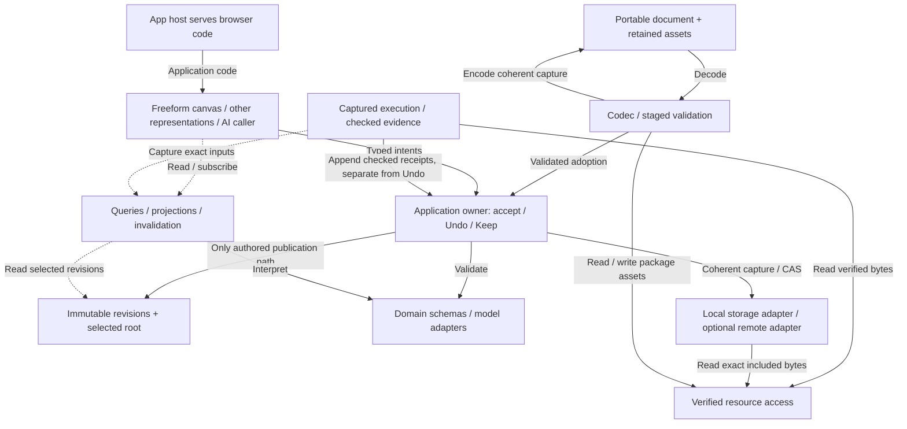

# Foundation and application interfaces

**Status:** Architecture design baseline, reviewed 2026-10-27; bounded typed execution
proof passes. The primitive basis and accepted foundation behavior remain authoritative.
The application API is a design target, not a shipped SDK, schema migration or production
capacity claim. [Readiness audit](foundation-readiness.md) identifies the supporting evidence.

Manifold should be a freeform engineering canvas whose meaning survives a new layout,
a different renderer, a new computer and an unavailable tool. Build it as a modular
application over a small document kernel. Keep engineering schemas above that kernel;
use explicit interfaces for accepted changes, derived reads, execution and durable I/O.

Read the [vision](../vision.md), [reduction audit](primitive-basis.md) and
current implementation evidence (local-only report) alongside this
design. The contract sketch (local-only experiment)
makes interface direction and types concrete. Its compiler checks establish type
separation only. They do not establish concurrency, performance or adapter correctness.
The [operation flows](application-boundaries.html) show the proposed edit, computation
and portable transfer boundaries.

The shared application foundation migration (internal design note) is achieved and verified.
[ADR 0023](decisions/0023-owner-controlled-domain-validation.md) implements synchronous
domain validation inside the existing owner; [ADR 0024](decisions/0024-canvas-workspace-lifecycle-and-typed-commands.md)
implements typed canvas command payloads and its workspace I/O facade. These production
slices preserve current native formats and UI. The broader ports below remain a target;
the broader public SDK is not implied. [ADR 0028](decisions/0028-shared-typed-execution-evidence.md)
now implements typed receipts in the existing foundation owner/codec; canvas sampler adoption is now implemented by [ADR 0029](decisions/0029-canvas-sampler-on-shared-evidence.md).

[ADR 0026](decisions/0026-canvas-model-composition-and-portable-captures.md) adopts independent
scalar model scope, public/CSV bindings and full portable captures in the existing canvas.
The [implemented extension patterns](canvas-extension-patterns.md) identify actual production ports
and their executable checks; broader SDK and product-capacity gates remain feature-specific.

[ADR 0025](decisions/0025-shared-scheduling-and-session-computations.md) now shares bounded
scheduling and gives the canvas sampler one session-owned computation service. Views observe
it; they do not execute or own checked data. The earlier scalar/core and sampler lanes are now one evidence protocol. The sampler uses the foundation typed receipt/storage contract; its separate result lane is retired
by [ADR 0029](decisions/0029-canvas-sampler-on-shared-evidence.md).

[Targeted authoring](decisions/0030-targeted-canvas-authoring.md) now shares unchanged worksheet
records instead of cloning full Pages. [Complete-state capacity](decisions/0031-coherent-retained-capacity-and-rescue.md)
checks authored/evidence/resource candidates before publication, aligns admitted work with bounded
native/local handoff, and supplies verified saved-work rescue.
[Authored scene records](decisions/0032-portable-authored-canvas-scene.md) now carry groups, tools and
named model/camera layouts through the same owner/Undo/storage. Real tool input/render/page-JS and
process-RSS observations extend the workload set; they do not establish every renderer or source
adapter’s capacity. [ADR 0033](decisions/0033-atomic-layout-and-renderer-input-boundaries.md) closes atomic layout and
renderer-buffer transition boundaries. Final verification is tracked in the parent acceptance audit.

## What we build on

Retain three semantic distinctions. These are necessary information, not three
mandatory tables or a fixed serialization:

| Basis | Required meaning | Concrete removal failure |
| --- | --- | --- |
| Stable identity | Document authority, independently editable item lineage and complete nested occurrence identity. Labels are presentation. Content digests identify bytes, not editable occurrences. | Two identical springs need separate edits; `left/k` and `right/k` must remain distinct. R01, R02, R04, R16. |
| Immutable typed revisions | An identified revision declares its versioned interpretation and retains its selected payload or asset handles. New meaning creates a new revision. | The same `{value:3}` cannot silently change from mm to s; equal-valued source revisions still have distinct provenance. R03, R06, R11. |
| Qualified references and explicit resolution | Name authority, item, pin/follow policy and versioned part selector; resolve in an identified environment, including recorded absence. | Pinning a request alone does not freeze its inputs; a previously absent input must not appear in a saved alternative. R05, R07, R08, R15. |

Three protocols preserve those distinctions: atomic accepted changes, derived reads
with execution evidence, and verified resources with guarded durable publication.
The [audit](primitive-basis.md#removal-counterexamples) supplies counterexamples for
each retained guarantee, including Undo/evidence separation, save conflicts and ID
nonreuse. It does not prove a mathematical minimum.

Presentation records, named alternatives, model templates, instances, ports, data
relations, requests and kept conclusions are compositions of this basis. Their schema
handlers declare references, assets and evidence links. They do not each need a new
kernel collection, scheduler or storage engine. Current dedicated View/Alternative
collections remain until full lifecycle and cost parity justify migration. Ordinary
typed content is a demonstrated candidate, not a completed replacement.

An authored relationship may be cyclic or unresolved. An executable method has its
own supported input/domain rules. Grouping does not imply dependency; compatible units
do not imply physical equivalence. A successful execution says nothing by itself about
physical validity or satisfaction of a requirement.

## Architecture choice

Prefer a **typed revision kernel with domain adapters and one application owner**.
Keep it in one process initially, with a worker/process boundary for expensive or
untrusted execution when that is actually implemented.

| Option | Fit with the vision | Disposition |
| --- | --- | --- |
| Extend the worksheet and React callbacks as the shared model | Fast for the current worksheet; symbol scope, result ownership and portability become feature-specific. | Preserve it behind an adapter while migrating useful slices. Do not make it the shared foundation. |
| Universal engineering graph, event log or entity/component framework | Can encode many things, but does not itself define identity, source authority, reproducibility or safe edits. Adds schema and replay obligations before a concrete need. | Do not introduce as the foundation. Use typed domain relationships and derived indexes where needed. |
| Small revision kernel plus application ports | Independent meaning and representations, explicit sources, reversible exploration and optional tools share one lifecycle. Costs remain measurable at each seam. | Chosen design direction; tested foundation plus bounded typed-execution proof. |
| Distributed services or collaboration-first shared state | Could support later multiuser work; requires conflict, presence, access and merge semantics that local CAS does not supply. | Separate later decision driven by a collaborative workflow. Keep transport behind these ports. |

Modules are responsibility boundaries, not separate services. Do not introduce a DI
framework, global event bus, generic plugin loader or database per module. A composition
root wires concrete adapters and passes each caller only the ports it needs.

Here the owner includes separate authored and evidence publication lanes. The job
adapter submits output to validation; it has no raw state writer. The portable file
contains data and requirements, not installed handlers, credentials or job permission.
The app host delivers code. An optional execution host runs typed jobs. An optional
remote record store persists immutable records and guarded heads. These roles can
share a server but cannot quietly become each other's authority.

## Application ports

The TypeScript sketch (local-only experiment) describes
the target surface. Domain actions remain a closed typed union per application, rather
than arbitrary strings with unchecked payloads. An interface can be implemented by a
few functions; each row does not require a class or package.

| Port | Owns / exposes | Must not do | Current anchor and remaining work |
| --- | --- | --- | --- |
| Reads | Owner-issued immutable snapshot, bounded record queries, qualified projections and filtered change subscriptions. | Publish edits, fetch hidden newer sources or retain unlimited old roots. | Foundation reader, generic projection reader and shared selection engine exist. Bounded app queries, resource invalidation and snapshot lifetime API are proposed. |
| Commands | Stage a typed intent against a snapshot; return a reviewed candidate; atomically accept once or reject; Undo through the same owner. | Publish a valid prefix, trust a caller-made candidate, perform external writes while staging. | `owner.apply` prepares and runs trusted synchronous app validation before publication. Canvas requests are now a closed discriminated union with exhaustive dispatch; UI `run` closures remain presentation adapters. A general staged-handle API is still proposed. |
| Exploration | Candidate previews, explicit cancellation and a reviewed Keep candidate with comparison/presentation changes included. | Modify accepted content during a drag or accept against changed relevant meaning. | Shared preview selection/guards exist in foundation; the canvas still adapts legacy worksheet contexts. New Keep surface must reuse those rules. |
| Computation | Capture exact typed inputs, schedule bounded jobs, validate attempts and append immutable receipts. | Read live mutable inputs mid-job, edit authored inputs on completion or equate success with validity. | Scalar/core and canvas sampler now share bounded scheduling. Canvas renderers read one session service; the owner admits checked output once. The foundation now admits typed/scalar receipts through one owner and native/local storage. The canvas sampler now uses this same receipt/store/clock path; broader performance/interaction gates remain open. |
| Resources | Acquire exact assets, verify identity, expose availability and release leases. | Treat unavailable data as zero, substitute current bytes or publish partial unverified input. | Current synchronous verified string reads exist. Async acquisition, binary/range access and leases are proposed. |
| Workspaces | Inspect an inert package, adopt a validated staged Open, capture coherent work, export, guarded Save and exact acknowledgement. | Start imported code, replace accepted work on failed Open, or acknowledge newer work with an old Save. | Native codecs, capture branding, coherent IndexedDB CAS and recovery exist. The canvas now uses one Save/Open/New/Export facade with edit-buffer and stale-work guards. General package access and streaming remain proposed. |
| Maintenance | Review protected semantic retention, then separately review/reclaim obsolete durable records. | Make cache eviction semantic deletion or reclaim data under an active read/export/job lease. | Full-reader retention/reclamation exists; partial readers need explicit lease and epoch coordination. |
| Session | Text buffers, local selection, camera, gesture and focus. | Become a second accepted document or serialize callbacks/DOM handles into native work. | Existing React/RegionSession interaction state; migrate only where it violates ownership. |

## Reads, edits and invalidation

An owner-issued snapshot identifies a coherent authored/evidence selection and its
workspace binding. Queries on it never drift to a newer root. Handle provenance and
lifetime are runtime checks; TypeScript branding alone is insufficient. Snapshots,
candidates and previews consume bounded retention leases. Release them explicitly;
Open/dispose expires transient handles. Only accepted content, named captures and
declared evidence roots establish longer-lived retention.
Accepted snapshots and preview snapshots have separate handle types. Both support
inspection and execution capture; a preview cannot be saved or used as the base for an
ordinary accepted edit. Keep stages an explicit reviewed candidate through exploration.
Already admitted exports/saves/jobs hold their own bounded leases: Open prevents new
admission from old handles and detaches old completions from current state, while an
in-flight effect may finish against its capture. Dispose requests cancellation and
releases leases only after consumers stop using them. Never delete bytes still in use
merely because a cancellation signal was sent.

Use indexed, bounded queries for canvas visibility and document lists. A page cursor
is scoped to snapshot, filter and order; reject reuse against another selection.
Projection reads return resolved, missing, loading, unavailable, unsupported,
ambiguous or corrupt. A missing source and an invalid formula are different outcomes.
A synchronous projection may report loading; a resource acquisition port performs I/O
and emits invalidation when the exact requested data becomes available.

Subscriptions atomically register with an initial snapshot, closing the gap between
first read and listening. They report authored IDs, affected semantic IDs, presentation
IDs, evidence keys and resource availability separately. Events have a monotonic sequence
within a binding, including availability changes that leave authored/evidence stamps
unchanged. Deliver after complete publication; reads
in a listener see the published selection. Bound queued notifications and coalesce to
an explicit reset if deltas overflow. Listener failures cannot roll back publication.
Reentrant edits are rejected or queued by a documented policy, never interleaved with
an incomplete publication. Unsubscribe/dispose releases listeners and transient leases.

Stage records the candidate's relevant read coverage: selected revisions, absences,
pin availability, interpretation and workspace binding. Commit revalidates it, validates
new records, applies the complete intent to the current root, and publishes once.
Unrelated layout changes may survive a semantic preview, while a same-valued relevant
revision invalidates it. Start with the current conservative expected-stamp check for
ordinary edits; narrower guards require evidence before replacing that behavior.
Resource-dependent review acquires the verified immutable inputs first and retains
their leases through commit. Availability changes cannot bless different bytes.

A staged candidate is opaque and owner-issued, single-use, bounded and discardable.
It is not a portable command or trusted patch. A serializable intent carries an
operation ID and typed arguments; admission validates shape, authority and domain rules.
Review means domain validation plus an inspectable change summary. Routine edits may
stage and commit within one interaction; this contract does not add a confirmation
dialog to every action. Keep or a lossy external mapping can expose the relevant choice.
Retries within a documented bounded operation-ID window return the prior outcome;
outside it, return an explicit unknown/expired outcome rather than promise exactly-once.
Undo is another publication selecting prior authored state; result arrival is outside
that history. Durable write failure leaves accepted work intact and exportable.

A projection is a read representation. Editing one invokes a domain action naming its
authoritative source, selected revision, selector and conversion. The adapter reviews
loss, ambiguity and permission. There is no universal `set(projectedValue)` operation:
editing an imported table cell, changing an instance binding and modifying a CAD face
have different authority and validity rules.

## Execution and extensibility

The isolated non-scalar proof (local-only experiment) now passes;
the foundation now implements a compatible typed adapter ([ADR 0028](decisions/0028-shared-typed-execution-evidence.md)).
The canvas sampler now uses this boundary through installed method/transport adapters
([ADR 0029](decisions/0029-canvas-sampler-on-shared-evidence.md)); broader resource and
application acceptance gates remain in the parent brief.
Keep the current scalar adapter and old receipts readable. A typed value has a versioned schema
and JSON descriptor; large arrays, meshes or native files use declared asset handles.
The schema validates the descriptor, type-specific meaning and reference/asset closure.
Do not serialize large binary payloads as per-element revision records.

An execution plan contains method/version/runtime identity, configuration, exact input
values or immutable descriptors, actual transitive projection origins, verified assets
and required output schemas. An execution key canonically covers everything the method
can observe that affects meaning, including seeds or declared nondeterminism. Layout,
hover and result arrival do not enter that key. Undeclared source reads reject. Capture
may conservatively retain more than the actual execution dependency trace.

The plan is inert. Explicit submission acquires admission and resource budgets, then
hands an immutable manifest to an adapter. Outputs must pass schema, asset integrity
and provenance checks before receipt publication. Large output assets are staged and
verified before publishing references to them; failed attempts leave only reclaimable
staging data. Progress is transient, sequenced and bounded. Cancellation is a request;
an adapter ignoring it still consumes a job slot until it terminates or its host is
actually stopped. Open changes binding; late completions cannot attach to the new work.
Release completed job handles separately from retained receipts; a job registry is not
an unlimited history. Releasing a running handle must not bypass its admission slot.

One execution key can have multiple attempts, particularly for nondeterministic or
remote tools. Receipt identity is separate from key identity. The current association
policy must identify which validated attempt it displays. Historical evidence remains
inspectable when current inputs or runtimes are unavailable; it cannot establish current
recomputability. Explicit Keep creates authored content referencing the chosen evidence.

The receipt also retains its frozen resolution selection and publication sequence.
Selection is validation/retention evidence, separate from the manifest used for the key;
do not key on unrelated retained closure. Successful admission consumes a plan and
transfers its leases to the job. Output validation reads those same leases if the
provider becomes unavailable. Cancellation is idempotent and terminal publication is
final even if an observer asks to cancel. Adapter read/stage/progress capabilities
expire at settlement. These are executable lessons from the scalar/vector proof.

Installed schema, renderer and method adapters are trusted code. Files only declare
requirements. Unknown required contracts reject adoption; today's unknown-optional
fallback preserves original bytes read-only. Selective editing around unknown content
is a future capability proof, not granted by this design. A new renderer adds no source
authority; a new schema must declare dependencies and retention links. An arbitrary
solver or CAD runtime requires process/resource isolation beyond the current trusted
bounded synchronous model evaluator.

External-tool writes require their own domain workflow: prepare against an identified
remote revision, show the proposed mapping/loss, execute with idempotency and remote CAS
where supported, then import the verified resulting revision through a local command.
If the remote edit succeeds and local acceptance fails, record the remote outcome and
offer reconciliation. Do not claim an atomic transaction across an external tool and
local storage. Credentials, filesystem access and network permissions remain adapter
capabilities, never document payload. AI calls the same typed application operations
with the same guards; it gets no privileged root mutation or automatic execution path.

## Portability, persistence and recovery

The native package carries format/schema requirements, semantic identities and nonreuse
metadata, selected revisions, named captures, authored presentation, selected evidence, required retained
closure and included asset bytes. Linked assets carry exact identity and explicit
availability limitations. It excludes hover, running jobs, credentials, caches and
session Undo. A user-saved draft is ordinary typed authored content; a transient buffer
must be explicitly accepted as a draft before a Save can claim to include it.

The codec stages decoding, migrations, closure checks and an inspect/edit/recompute
capability report. Failed Open preserves the current owner and original bytes. Adoption
changes binding and expires old transient handles. Duplicate document IDs on import do
not authorize merging: mount another authority or perform an explicit copy/remap with a
reference map. Cross-document mounts remain explicit and may be unavailable.

Native format and physical storage are independent. Current content-addressed local
records/branches are an implementation choice. Save captures authored root, evidence
selection and owner binding together, writes verified assets/records, then CAS-publishes
the durable head against the destination generation. A conflict preserves both durable
work and accepted memory. Acknowledge the exact capture only; edits or evidence arriving
in flight remain unsaved. Export reads that same capture under a lease and either emits
a complete package or fails. A package can contain linked unavailable assets, but cannot
claim missing bytes are included.

Cleanup traces accepted/named selections, Undo, kept evidence/source pins and active
captures/jobs/exports. Semantic pruning and physical deletion have separate reviews.
A future lazy reader must register leases before reclamation is enabled; the existing
full-reader tests do not establish safe partial-reader reclamation.

## Cost model and operating limits

Let N be retained metadata records, k changed records, A affected semantic dependents,
R/E the captured reachable revisions/edges, V visible representations, and B bytes read.
These are design obligations to measure, not claims that all current app paths meet them.

| Operation | Intended work / bound | Important remaining cost |
| --- | --- | --- |
| Local edit | Shared-map path updates roughly O(k log N), plus domain validation and O(A) invalidation. | A can approach N. Current Page adaptation/global worksheet evaluation can still scan broadly. |
| Move a representation | Update that presentation; do not reevaluate semantic inputs. | Ordinary-content presentation revisions may cost more than current View records; compare before migrating. |
| Resolve/capture | Visit selected closure within configured node/edge/depth budgets. Shared selection avoids repeated declaration walks. | Traversal/index construction and bulk-map ordering still cost; repeated captures need bounded caching keyed by exact dependencies. |
| Render/query | Indexed visibility lookup plus O(V) mounted views, bounded list pages. | Spatial indexes, virtualization and app selectors are proposed; full-root React rerenders are not a scale strategy. |
| Execute | Per-method bounded queue, concurrency, input/output bytes, time and progress limits. | Device/process capacity and each method's complexity; isolation is a separate host responsibility. |
| Save | Reuse acknowledged immutable branches and write changed physical data. | New/unacknowledged destinations, full validation and export may traverse all retained work. |
| Open/export/cleanup | Explicit O(N + B) full-reader operations initially, with progress and cancellation between bounded stages. | Existing synchronous parsing needs a worker or streaming design for large work; no frame-time claim. |
| Application startup | Load core authoring and explicitly installed optional adapters within a measured delivery budget. | Modules do not automatically create separate browser bundles. The current app build warns about its roughly 699 kB minified JS chunk; cold-start/loading budgets remain unmeasured. |

Load optional renderer/tool code from application-controlled modules when needed;
never interpret a file's schema requirement as permission to import arbitrary code.
Measure startup/download/initialization separately from edit latency and model capacity.

Budget metadata, assets, retained Undo, recent results, previews/captures, caches and jobs
separately. Keep decoded caches bounded by accounted bytes and entry count; retain keys
and compact manifests rather than accidental whole-document roots. Limit parser depth,
selector expansion, model depth and provider output sizes at admission. Return a typed
limit error before partial publication. Backpressure is observable; do not grow an
unbounded promise queue or silently discard authored work.

The existing selection diagnostic (local-only report)
and foundation evidence (local-only report) establish bounded
implementation behavior. They do not establish a maximum project size or user latency.
Before a capacity promise, choose representative hardware and sparse/high-fanout projects;
record p50/p95 latency, visited records, allocations, actual retained bytes, queue length,
main-thread stalls and recovery time. Double independent dimensions separately: records,
instances, visible views, asset bytes and historical selections. A better asymptotic map
does not remove expensive schemas or actual dependency fanout.

## Build order and decision gates

This sequence records the 2026-10-27 adoption plan. The typed owner, actual sampler, independent
canvas scopes, targeted authoring and retained-capacity policy now ship through the ADRs above.
Use the active parent goal (internal design note) for remaining implementation order.

Do not migrate every interface at once. Keep existing file fixtures and canvas workflows
as compatibility gates. The probe brief (internal design note) records the
passing first proof; [ADR 0022](decisions/0022-application-ports-over-revision-kernel.md)
accepts the architecture direction and bounded seam without claiming an implemented SDK.

1. **Typed execution proof passes in isolation.** One scalar adapter and one asset-backed
   vector/mesh method use the same capture/evidence lifecycle. Test equal outputs with
   changed source/method, late jobs, unavailable assets and portable reopen. Do not yet
   add an external writer or migrate the product's worksheet. The 21 scenarios and
   1/10/100-occurrence diagnostic pass; production integration remains a later slice.
2. **Wrap one existing canvas action.** Adapt the current owner and command resolver to
   typed reads/stage/commit; use one existing edit/Keep/Undo/save journey. Preserve freeform
   UI. Test stale candidates, failed validation and exact save acknowledgement before
   replacing more handlers. Add no second accepted-state owner.
3. **Integrate independent model scope.** Use existing templates/instances/public ports
   through that facade. Prove two identical instances edit independently and same-valued
   transitive changes invalidate the right evidence. Preserve legacy scope via its adapter.
4. **Migrate representations only on parity.** Compare ordinary-content presentations
   and named captures with current collections across editing, Keep, Undo, cleanup,
   old-format reopening, invalidation and costs. A measured regression can justify
   retaining a specialized physical index without making it a semantic primitive.
5. **Add large-source and real-tool adapters.** Prove async verified assets and leases
   before partial reading/reclamation; prove one external revision/writeback workflow
   before generalizing integration. Adopt streaming containers or remote storage only
   when the measured source/workflow requires them.

The application acceptance audit (internal design note) tracks the implemented
interaction/extension contracts and their final verification. Broader projection/renderer/source
capacity remains feature-specific. Authored scene portability and representative tool input/render/
memory observations now have executable witnesses; current measurements do not establish universal capacity. Async/lazy sources and external writeback need their own
bounded workflows before adoption. Adding more base record kinds does not resolve these. A new kernel primitive
needs a concrete user scenario, a remove-or-merge counterexample, failure/recovery rules,
portable encoding and cost evidence that compositions cannot reasonably supply.

## Historical design verification

These are dated design-review results, not current check instructions or an outstanding
adoption backlog. Public verification commands live in the
[development guide](../development/README.md#checks).

2026-10-27: the local-only application contract probe passed strict types and nine negative
compile checks. At that review, all 114 core tests and 24 reduction probes passed with unchanged
foundation source digest `sha256:36ca79c21274bfcbf91476fe59fa25354de99133e6364d18c95f99dc2052d0db`.
`make check-docs-worktree` checks local links/anchors, including these untracked drafts,
and the existing deployment/ownership diagram summaries. The operation-flow page was
previewed at 728 and 320 pixels; all three flows pass local DOM assertions without
console errors. The source-identified typed execution proof (local-only experiment)
adds 21 passing scenarios, an actual fresh-process handoff and measured independent
occurrences sharing source bytes. Production runtime, native formats and application UI
remain unchanged. `make check-canvas` also passes formatting, build and 23 local checks
against the unchanged app source. At that review, full API and product adoption were future
implementation work; use the [extension patterns](canvas-extension-patterns.md) for current ports.
