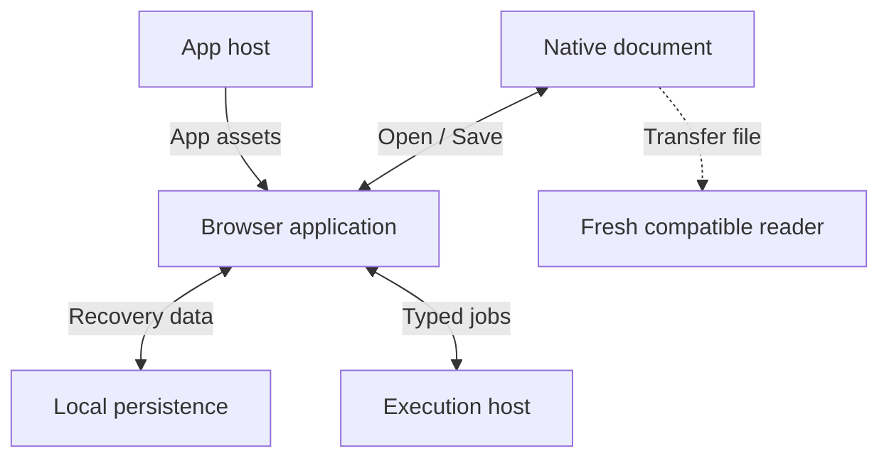
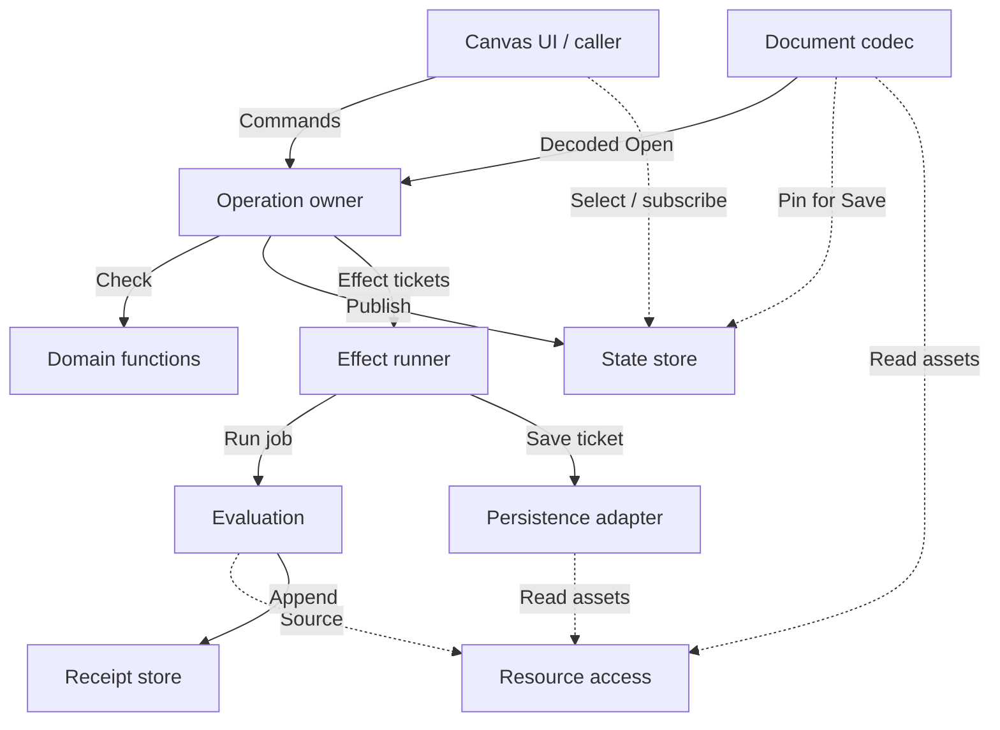
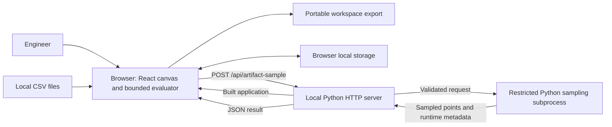

# Architecture baseline

**Current production status, 2026-10-28:** the shared application foundation and canvas migration (internal design note)
is achieved and verified within its bounded scope. The [implemented extension patterns](canvas-extension-patterns.md)
own the production ports; the [repository map](../repository.md) owns code locations and package boundaries.

The foundation owns accepted immutable document changes, preview/Keep/Undo, checked execution
receipts, resources and durable publication. Canvas domain adapters provide schemas, explicit
model/source bindings and retained-capacity validation. Application ports coordinate commands,
Save/Open/recovery and renderer buffers. Renderers project accepted state and submit intents;
layout previews and active attention remain transient. Authored groups, tools and named layouts
are ordinary portable records. Scalar models, model analyses and sampling share one evidence clock/store. Reusable equation
definitions and bounded sweeps are installed application adapters; one analysis receipt supplies
its table/curve and retained input/source inspection. Worksheet preparation, numerical projection
and sampled curves share a bounded disposable derivation adapter. It owns no accepted state,
history, execution currency or persistence.

See ADRs [0029](decisions/0029-canvas-sampler-on-shared-evidence.md),
[0030](decisions/0030-targeted-canvas-authoring.md),
[0031](decisions/0031-coherent-retained-capacity-and-rescue.md),
[0032](decisions/0032-portable-authored-canvas-scene.md) and
[0033](decisions/0033-atomic-layout-and-renderer-input-boundaries.md),
[0035](decisions/0035-authorable-scalar-models-and-general-outputs.md) and
[0036](decisions/0036-model-backed-analysis-requests.md) and
[0037](decisions/0037-bounded-incremental-worksheet-derivation.md) for the adopted boundaries and costs.
Current evidence (local-only report) records checked workflows and limits.

The original F1–F6 sequence (internal design note), isolated experiments and
[interface design](application-interfaces.md) retain historical/proposed scope. Broader ontologies,
a universal SDK, general solvers and partial-source access are not implied by current adoption.
The diagrams below express the broader responsibility model; they are not deployment promises.

## Proposed system block diagram

The [two rendered views](system-block-diagram.html) separate deployment from ownership.
They describe proposed contracts, not implemented guarantees or a universal engineering
schema. Their shared graph definitions live in that HTML file; the Mermaid blocks below
are generated summaries checked by `scripts/check_architecture_diagrams.py`.

### Deployment: where things run

<!-- architecture-diagram:deployment:start -->

<!-- architecture-diagram:deployment:end -->

The browser is the initial host for a platform-neutral document runtime. The same pure
contracts must work in F1's separate-process tests; a future headless reader can use
them without mounting React. No headless product or new service is required now.
The app host delivers application code, while the browser renders and edits work.
A native document can be opened locally without uploading the whole project.

Today one loopback Python process both serves built assets and exposes the restricted
sampler. Those are distinct roles with independent interfaces. Execution hosts remain
optional for methods that need them; the current sampler is not a general Python/CAD
host. A compatible app must still be available to open a document. Offline application
installation/caching is a separate delivery task, not a property supplied by the file.

### Ownership: who can read, publish and perform effects

<!-- architecture-diagram:ownership:start -->

<!-- architecture-diagram:ownership:end -->

Arrows in this view are directed interface requests. Dashed arrows are read/subscribe
access; solid arrows are commands or explicit effects. Returns are described by the
contract, rather than ambiguous two-headed arrows. Modules are not separate services.

**One writer:** the accepted-state store owns the current immutable root pointer.
Only the application operation owner can publish a replacement. Domain functions own
rules, not a second mutable document. Persistence and execution adapters cannot publish
accepted authored state. Views select/subscribe directly; ordinary reads do not pass
through the operation dispatcher.

### State categories and authority

- **Accepted authored state:** content/source revision selections, typed authored
  relationships, context policies and saved presentation records. One root identifies
  a coherent selection; it does not inline every array, field or native file.
- **Immutable retained records and assets:** revision payloads, source bytes and
  evaluation receipts referenced by identity. Repositories may append validated records;
  appending evidence cannot rewrite an authored selection. Reachability/retention rules
  decide what survives export and pruning, independently of cache eviction.
- **Derived runtime state:** dependency/reverse indexes, pending jobs, result-key
  associations and bounded caches. Rebuild or invalidate them from identified inputs;
  they are not alternate authorities for authored meaning.
- **Interaction state:** active text buffer, preview, hover, selection and camera.
  It is separate from authored history. Explicit Save retains active text as a draft
  through an operation; unaccepted numeric previews remain temporary. Saving a named
  view/arrangement is an explicit authored presentation change.

A publication includes the new root and affected IDs. Effects carry a pinned root,
operation/request identity and declared inputs. This does not prescribe a full scan,
whole-document clone or one serialization per pointer event. Selectors use affected
IDs/indexes; continuous previews have a separate ephemeral path. Costs need
measurement; immutability and a single writer alone do not establish scalability.
F1b evidence (local-only experiment) demonstrates one viable physical
candidate: immutable AVL paths, import/revision-derived compatibility and bounded
Undo selections. It does not select production storage, make retained revision
history bounded or establish browser rendering performance.

### Minimal contracts to prove in F1

These are interface obligations for the bounded slice, not final TypeScript names or
an exhaustive ontology. Use concrete text and table schemas; no general plug-in registry
or command bus is needed to exercise them.

1. **Retained item/revision:** independent document/item lineage, immutable revision
   identity, declared schema/version and inline small content or asset references.
   A draft is retained content with unresolved interpretation, not a failed transaction.
2. **Qualified reference:** document/item, explicit follow-or-pin selection, selector
   type/version and required type. A table row/column coordinate is valid only in its
   selected source revision; a changed source cannot inherit equivalent meaning by index.
3. **Resolution result:** resolved typed projection with provenance, loading, unavailable,
   missing target, ambiguous or unsupported. A pure resolver interprets supplied revision
   metadata; an I/O-backed resource-access port obtains missing metadata/bytes. Neither
   chooses another same-named target as a fallback.
4. **Accepted root/read interface:** `read/select/subscribe` exposes immutable selections
   and change information. It grants no write access and contains no browser handles.
   Projection edits name the authoritative source owner; a view/cache cannot be another
   editable master.
5. **Operation result:** expected-base check and pure validation produce rejection, or
   a candidate plus change set and explicit effect tickets. The owner publishes once,
   records the authored recovery step and then enqueues effects. Rejection publishes
   nothing. Undo publishes a new sequence selecting retained prior authored state.
6. **View record:** independent identity, qualified targets, supported renderer/version
   and saved presentation settings. Numerical method parameters belong to computation
   requests/definitions; positioning another view does not create another quantity.

These contracts must demonstrate two different content kinds and compare against the
simpler worksheet-bound reference approach. A generic label such as “typed resource”
is not acceptance evidence. Competing observations, declarative relation direction and
model instances remain F2–F6 questions rather than hidden assumptions in F1.

### Resource access and large information

Use one logical resource-access interface for package entries, local retained records
and explicitly requested external sources. It resolves a pinned resource revision or
asset/range through a registered, versioned provider for the concrete content kind.
This is an adapter boundary, not a new server, universal schema or eagerly loaded map.
Codecs, evaluators and renderers must not invent different source-loading semantics.

Keep semantic selector resolution separate from byte access. A face/cell projection
needs its owner's typed selector contract; a blob digest identifies bytes but cannot
prove physical equivalence or geometric continuity. Mutable availability and integrity
status are separate from immutable source identity. Support loading, unavailable and
unsupported states; a cache miss is never deletion or a numeric answer.

Large assets stay behind immutable handles, with chunk/range access when supported.
Append returns verified content identity; it cannot replace a selected source with newer
bytes. Asset reads and network/native-tool calls are effects performed by adapters.
The domain functions receive data/metadata and return values or unresolved states; they
perform no I/O. The production store may page large record indexes as well as bytes.
F1 may load small metadata eagerly, but must disclose the resulting cost.

A package's entry index, declared sizes and required-reference closure can be checked
before full asset decoding. Payload digests may be verified eagerly for F1 fixtures and
on first read in a later lazy reader. Until checked, data is explicitly unverified;
no computation may treat a digest mismatch as valid input. “Opened” and “all asset
integrity verified” are different claims. Missing supposedly included bytes are package
corruption, not an intentional linked dependency.

### Bounded operations and explicit effects

The operation owner coordinates publication and authored Undo. It does not render
projections, parse every source on each read, own job queues, copy asset buffers or
implement storage migrations. Pure domain modules validate the concrete operation;
selectors and derived indexes support direct queries.

An effect runner receives explicit tickets after publication: save a particular root,
evaluate a pinned request, or perform an allowed adapter action. It owns deduplication,
ordering/cancellation policy and completion routing; it cannot write the accepted root.
This may start as a few typed callbacks, not an event framework. A save completion
acknowledges its captured authored root, retained-evidence version and destination
binding. Receipt arrival can make the capture older without changing the authored root.

The evaluation coordinator handles method scheduling and derived result associations.
It reads pinned sources through resource access, validates returned data and appends an
immutable receipt to the evidence repository. It checks the current requested execution
key before exposing a result as current. Results can be reused for matching inputs after
Undo. An old receipt cannot supply missing current inputs. Receipt arrival creates no
authored Undo step. Explicitly retaining a conclusion/comparison is an authored operation
that references evidence; caching or reading a result is not.

### Decode, validate and negotiate reader capabilities

The codec checks encoding, container/root versions, structural data and asset indexes,
and applies explicitly supported format migrations in staging. Domain validation checks
identity, references, selector semantics, units/types and valid state transitions. Adapter
output validation checks the declared method result, not physical validity. These are
separate checks, not one catch-all “validated” flag.

The package declares format and content-schema/resolver versions plus relevant renderer,
method and runtime requirements. Loading produces a scoped capability report:

- **Inspect:** which content, metadata and saved representations can be shown, with
  unavailable or unverified dependencies identified.
- **Edit:** which authored portions can be changed without losing or retargeting data.
  Unknown optional payloads are preserved losslessly; affected edits are disabled when
  their cross-references cannot be validated. Fall back to read-only rather than strip.
- **Recompute:** which requests have all required sources, supported methods/runtime
  and verified inputs. A missing solver need not prevent editing an independent note.

Unknown required root/schema contracts reject adoption without replacing current work
or original bytes. Optional extension handling does not imply that every edit is safe.
Open reads inert data; it does not execute code, fetch private sources or update revisions
without an explicit supported operation. See [portability](portability.md).

### Open, edit, compute, save and transfer

1. **Open:** the file adapter mounts a staged package source; the codec checks structure
   and versions and produces a decoded candidate plus capability/integrity report.
   Domain functions validate understood semantics; the owner alone publishes Open.
   Local recovery follows the same path. Failed load leaves current work intact.
2. **Edit/read:** UI commands call the owner; pure rules validate; the owner publishes
   one root/change set. Read-only selectors and keyed result queries bypass the write
   dispatcher. Views never mutate shared records directly.
3. **Compute:** an explicit ticket pins the accepted request context. The coordinator
   obtains needed data through resource access and invokes a supported local method or
   external host. Checked receipts go to evidence; derived current-result associations
   are keyed against the requested semantic inputs, not just workspace sequence.
4. **Save:** retain active authored drafts via an operation, capture one root and its
   evidence/source closure, then enqueue a save ticket. The codec reads that pinned
   selection and assets; persistence commits bytes/records before advancing the durable
   root. Failures preserve the previous durable root and distinguish accepted/unsaved
   work. Neither pure domain functions nor UI code writes storage directly.
5. **Transfer:** move the native document to a fresh compatible reader and repeat Open.
   Preserve lineage; an independent-copy operation remaps internal references explicitly.
   File handoff alone does not merge diverged edits or require a collaboration service.

The first buildable path is the **codec, reference/asset access, operation owner and
accepted-state store**, exercised headlessly with text/draft and table schemas. F1 proves
only its bounded identity, read/write, recovery and portable round-trip contracts. Rich
relationships, evaluation, context policy and production storage advance through their
own gates; this diagram does not select an exhaustive domain schema or a database.

### F2 browser and storage seam

The isolated F2 harness (local-only experiment) exercises a real browser loop
before production state migration. Its property/claim/relation/native record kinds are
concrete fixture schemas. Value authority remains with source bytes; relation roles
express authored meaning rather than execution direction. One operation owner publishes
content/views and semantic selections together; the incident index is derived.

The IndexedDB probe stages immutable assets/metadata and atomically compares/swaps one
durable generation. Reopen verifies bytes and semantics before adoption. Exact-root/
binding acknowledgements and draft-buffer checks prevent a stale completion from marking
new work saved or a late Open from discarding typing. This does not select production
storage, establish power-loss durability, or resolve asynchronous large-source access.
The F3 experiment (local-only experiment) now adds authored requests,
actual input/method keys, checked receipts and affected-request indexes. Receipt arrival
has its own version outside authored Undo. Root/evidence/binding checks protect Save and
late Open; native handoff restores evidence without executing. Source value changes
notify their dependents without rebuilding unchanged edges. This remains an isolated
fixture with a closed method catalog, eager source access and unbounded evidence retention;
the v0 package/workbench (local-only report) now closes the bounded
F4 coherent-alternative gate. Contexts retain only reachable selections and never borrow
a newer baseline. Repeated contexts/snapshots share transport metadata. The
retention slice (internal design note) now prunes unused current payloads while
protecting Undo, active captures and citations, with durable identity ledgers and evidence
sequence metadata. Incremental hot local saves (internal design note) now reuse
committed map branches and atomically publish changed batches; native transport stays separate.
Recovery restores physical shape only after owner validation. Reviewed stored-data reclamation
now guards coherent read snapshots and Save epochs. Full metadata validation, larger partial
sources and final container choices remain F5 work. The canvas owner/Keep and incremental storage (internal design note) gates now
pass. Protected app retention and saved-storage cleanup (internal design note) now pass;
compact snapshots/source pins (internal design note) now pass. Richer execution/
partial source access and independent composition remain separate integration. Recent/kept calculations (internal design note) now have explicit lifetime/authority boundaries.

## Context, containers and deployment today

An engineer uses a browser-based React canvas, imports local CSV data and can
export a portable workspace. Browser storage retains accepted work locally. A
Python server on loopback serves the built application and a bounded sampling API.
No live AI provider, remote collaboration service or native CAD service is connected.
The private native V7 file carries registered authored content/views, alternatives, scalar/analysis/sampler
receipts and verified resources in one foundation envelope. The conditional V5 writer and sampler
sidecar are retired; V1–V6 are read boundaries. No-execution file Open and fresh compatible-browser
handoff pass for worksheets and bounded independent scalar models. Broader arrangement/tool portability
and conditional-writer retirement remain open under the portability gates.

The production build is served from `apps/canvas/dist`; the server binds to
`127.0.0.1` (default port 58310). During development Vite uses port 58311 and proxies
API calls. This deployment does not establish a hosted or multi-user architecture.

## Implementation responsibilities today

| Responsibility | Source anchors | Architectural observation |
| --- | --- | --- |
| Canvas coordination | [Regions.tsx](../../apps/canvas/src/regions/app/Regions.tsx), interaction components and hooks | Coordinates editing, selection, commands, exploration and persistence; substantial coupling is visible here. |
| Accepted Page/history | [canvasDocument.ts](../../apps/canvas/src/regions/app/canvasDocument.ts), [foundation](../../packages/foundation/README.md) | One immutable accepted owner with frozen Page projections, independent region/artifact views and bounded Undo. Scalar/sampler evidence uses one checked clock/receipt map outside authored Undo. |
| Definitions and evaluation | [document.ts](../../apps/canvas/src/regions/document.ts), [math.ts](../../apps/canvas/src/notebook/math.ts) | Page/context state, projections and session operations over bounded arithmetic and units. |
| Connections and measurements | [linking.ts](../../apps/canvas/src/regions/linking.ts), [datasetModel.ts](../../apps/canvas/src/regions/datasetModel.ts) | Resolves explicit bindings and bounded dataset computations. |
| Model boundaries | [models.ts](../../apps/canvas/src/regions/models.ts), [modelCommands.ts](../../apps/canvas/src/regions/modelCommands.ts), [foundationModels.ts](../../apps/canvas/src/regions/foundationModels.ts) | Existing visual membership remains distinct from independent pinned scalar instances and reviewed public/CSV bindings. Both use the same accepted owner/history/storage. |
| Commands and exploration | [commands.ts](../../apps/canvas/src/regions/interaction/commands.ts), [exploration.ts](../../apps/canvas/src/regions/exploration.ts) | Shared command descriptions and proposal helpers; React coordination still applies effects. |
| Artifacts and execution | [samplingPlans.ts](../../apps/canvas/src/regions/samplingPlans.ts), [samplingExecution.ts](../../apps/canvas/src/regions/samplingExecution.ts), [artifactComputations.ts](../../apps/canvas/src/regions/artifactComputations.ts) | Normalized recipes lower to typed requests; the installed method checks returned results. The session service manages demand and observes the shared owner. |
| Persistence and navigation | [canvasLocalStore.ts](../../apps/canvas/src/regions/app/canvasLocalStore.ts), [canvasBootstrap.ts](../../apps/canvas/src/regions/app/canvasBootstrap.ts), [workspaceMemory.ts](../../apps/canvas/src/regions/workspaceMemory.ts) | One foundation snapshot, incremental Save, generation conflicts, validated recovery and V7 handoff pass; V1–V6/local bundles migrate at read only. Authored scene/group/tool/named-layout records now travel through the same owner; active attention remains personal. Protected app history/result retention and saved-storage cleanup now pass; compact computation/source snapshots and shared typed execution now pass bounded gates; general solvers/partial sources and broader renderer/source capacity remain open. |
| Sampling boundary | [server.py](../../apps/canvas/server.py), [artifact_sampler.py](../../apps/canvas/artifact_sampler.py) | Restricted grammar, request validation and timed subprocess execution; not a general Python sandbox. |

## Representative runtime: a connected response plot

1. The normalized sampling recipe projects through its versioned execution selector into
   a typed request. The core captures exact definitions, context, bindings and source pins;
   the request key excludes layout and unrelated content.
2. The demand service observes a current core receipt or calls the shared `compute` port.
   Its root-installed optional transport posts captured code/scalar inputs to `/api/artifact-sample`.
3. The server validates the request and runs the restricted sampler in a separate
   process with a timeout. It returns points and execution metadata.
4. Output staging verifies the captured code's digest/size. The installed method checks
   every returned point against the captured engineering model before core publication.
5. The shared receipt retains the closed request, context and runtime data. Currency is
   determined by core capture matching; obsolete requests are cancelled and terminal bindings
   reject late publication. Receipt arrival creates no authored Undo entry. Native V7 and
   incremental local Save retain this same capture without a sampler sidecar.

This is the current bounded path, not a contract for arbitrary external solvers.
Any richer executor needs an explicit capability, invalidation and source-revision
design. Cancellation on the client is not proof of server-side job cancellation.

## Proposed responsibility boundaries

These are logical modules within the application, not proposed services or a
commitment to reorganize files immediately.

| Boundary | Owns | Contract to resolve |
| --- | --- | --- |
| Domain functions | Pure identity, reference, type and transition rules | Validate supplied snapshots/metadata; return candidates/errors without I/O or a mutable root. |
| Accepted-state store | One accepted authored root and immutable read/subscribe access | Only the operation owner publishes; expose affected IDs without requiring full scans. |
| Application operations | Candidate preparation, publication, authored Undo and effect tickets | One write boundary across semantic and saved presentation selections. |
| Resource access | Versioned source/asset access through package, local and external providers | Separate selector meaning, availability, byte integrity and chunk/range access. |
| Evaluation and evidence | Scheduling, derived indexes/caches and append-only checked receipts | Current execution keys, explicit retained evidence and no authored Undo on arrival. |
| Representation and interaction | Rendered projections and ephemeral attention/preview state | Read directly; submit typed edits through operations; never mutate source records. |
| Codec and I/O adapters | Native-data structure/migration and explicit storage/tool effects | Scoped reader capability report, pinned save tickets and durable-version acknowledgements. |

A candidate dependency rule is that engineering semantics remain independent of
React and viewport state; operations coordinate changes; views call operations;
adapters translate external formats through explicit contracts. Evaluate this rule
against actual edit and execution paths before accepting it in an ADR.

## Native document boundary

[Portability](portability.md) is a core contract from F1, not a late export feature.
Semantic content, saved views, pinned revisions and source assets must be representable
independently of browser storage and runtime handles. The transport package and local
autosave database can have different physical encodings while preserving the same
accepted meaning. Inspection, editing and recomputation have separate dependency
requirements. Every slice must pass a clean-environment handoff for its own content.

## Proposed identity, context and ownership contracts

The [decision register](decisions/README.md#proposed-decisions) now compares
concrete options for the shared boundaries above. ADRs 0001–0003 and the concrete refinement in
[ADR 0004](decisions/0004-normalized-engineering-records.md) remain proposed,
not accepted architecture or implemented guarantees.

- [Identity and scope](decisions/0001-semantic-identity-and-scope.md): durable
  semantic IDs and immutable revisions; views refer to targets; model instances
  have independent identities and explicit ports.
- [Contexts and results](decisions/0002-context-snapshots-and-result-currency.md):
  alternatives pin full semantic snapshots, including equations, bindings and
  sources; execution keys cover resolved semantic inputs and method/runtime.
- [Operation ownership](decisions/0003-workspace-operation-ownership.md): a local
  workspace operation owner stages and publishes semantics and authored views
  together, coordinates Undo, and reports memory acceptance separately from durability.

The [Keep alternative lifecycle](operation-lifecycle.md) traces preview, acceptance,
Undo, persistence and partial failure in current code. It proposes a first
implementation gate that replaces cross-owner callbacks for this operation only.

## Concrete model and scale

The [data-model proposal](data-model.md) separates quantities, computation outputs
and numeric values; a context selects one complete semantic revision map. The
[scale assessment](scalability-and-flexibility.md) evaluates copying, dense maps,
shared bytes, dependency locality, retention and extension boundaries. Typechecked
fixtures and synthetic sizing are linked [evidence](model/evidence.md), not passing
production architecture or workload guarantees.

## Next architecture work

Follow the foundation sequence (internal design note), beginning
with F3's explicit-request/result-currency experiment on the tested F2 candidate.
F1b removes unrelated revision scans and dense edit-map copies, and bounds Undo
selections; retained revisions, identity ledgers, full transport and slower metadata
reads remain explicit tradeoffs. Its later slices map the P1–P4 probes
to relationships, execution, contexts and composition. Evaluate the evidence before
selecting a production data model. Keep/Undo is the planned application integration
case once its operation/reference/evaluation contracts are evidenced; it remains
bounded by its existing IDs/format scope and QS2–QS5 requirements. Identity and frozen-context format changes require staged
migration and compatibility fixtures; reusable instances and richer executors
remain separate work. The usability study continues independently. This proposal
does not authorize a broad rewrite.

[ADR 0026](decisions/0026-canvas-model-composition-and-portable-captures.md) and the
[implemented extension patterns](canvas-extension-patterns.md) cover current scalar model adoption,
full capture/native recovery, renderer buffers and terminal session teardown.
The parent migration (internal design note) keeps generic typed evidence, affected-record
writes, conditional legacy writer retirement and broad resource/performance acceptance open.

The [shared sampler decision](decisions/0029-canvas-sampler-on-shared-evidence.md) records the current
execution/file boundary: installed method validation and scoped resource I/O run inside the existing
core owner; demand services and renderers cannot admit output. Current/stale legacy results preserve
original meaning at import. The common owner also reserves bounded receipt metadata before execution;
it never silently evicts durable evidence. Current [extension patterns](canvas-extension-patterns.md)
and evidence (local-only report) identify the exact ports, cost tradeoffs and
remaining full-goal work.
