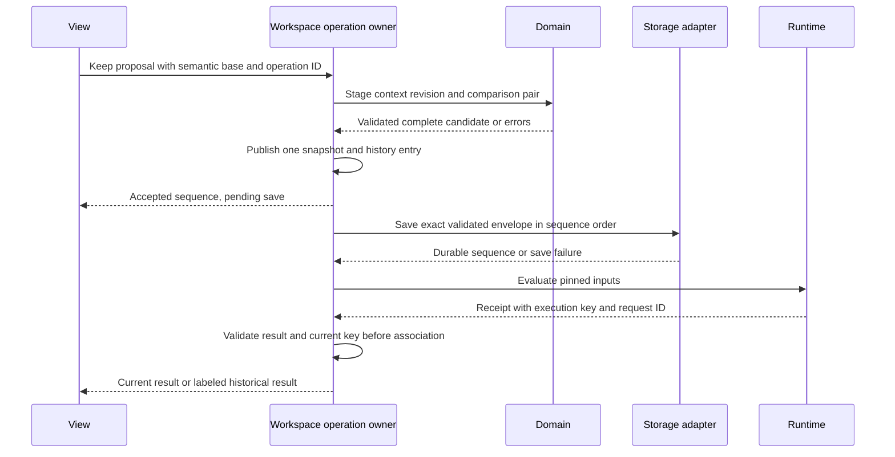

# Operation lifecycle: keep an alternative

**Status:** Source trace and proposed implementation gate, 2026-10-19. This is
architecture design, not a report of implemented transaction guarantees.

Use one concrete calculation: `k := 10 N/mm`, `x := 1 mm`, `F := k * x`,
a connected plot of `F`, and an optional measurement source for `k`. Preview
`x := 2 mm`, keep it as an alternative, compare, Undo, then reopen. The expected
baseline is 10 N and the alternative is 20 N. This isolates state ownership while
exercising the working loop (internal design note).

## Source trace and adoption update

The table retains the 2026-10-19 source trace. On 2026-10-26 the
first canvas adapter (internal design note) replaced accepted Page/history
with a foundation owner and native V2 handoff. At that gate RegionSession still held artifact
Undo callbacks. The [successor owner](decisions/0015-unified-canvas-operations.md) now owns artifact comparisons
and checked results, and K1–K5 passes in its bounded scope.
[ADR 0016](decisions/0016-coherent-canvas-incremental-storage.md) now saves authored/result roots
in one incremental IndexedDB transaction with validated recovery and explicit tab conflicts. Optional browser arrangement
callbacks remain outside native work and cannot restore artifact definitions. The remaining proposed
transaction contract below is unchanged.

## Original source trace

| Phase | Implementation evidence | Boundary / limit |
| --- | --- | --- |
| Propose | `exploreValue` in [Regions.tsx](../../apps/canvas/src/regions/app/Regions.tsx) calls `proposeValue` in [exploration.ts](../../apps/canvas/src/regions/exploration.ts). | Stores input, context, semantic key and text in interaction state; no accepted Page write. |
| Preview | `previewPage` overlays the selected context; `project` evaluates that Page. | Context/key mismatch returns accepted Page. The current key is a bounded equation/binding key, not the proposed full execution manifest. |
| Cancel | `revertExploration` clears proposal, gesture and variation state. | Accepted Page remains unchanged; preview is not archived. |
| Accept value | `applyProposal` checks context/key and affected errors, then calls `session.write`. | Writes accepted Page; it also sets interaction-local last-edit information. |
| Keep alternative | `keepExploration` captures artifact comparison fields; `branchValue` stages a new session, branches, writes and checks affected errors. | Publishes Page through `apply`; React separately updates artifact comparison fields and local comparison state. |
| History / Undo | `RegionSession.apply` stores prior Page plus optional callback. `undo` restores Page, invokes the callback and emits. | Callback restores captured artifact comparison fields; there is no common immutable workspace history record. |
| Save / reopen | React effect calls `archive(page, artifacts)`, validates via `restore`, then writes local storage. | Serializes Page and artifacts together, but the owners publish separately. Save failure shows an error; accepted memory remains. |
| Attention | [useWorkspaceMemory.ts](../../apps/canvas/src/regions/app/useWorkspaceMemory.ts) saves optional navigation separately; [workspaceMemory.ts](../../apps/canvas/src/regions/workspaceMemory.ts) validates it against a document-content key. | Optional recovery can be discarded. It is not a durable semantic identity contract. |

This trace identifies responsibility gaps; it does not demonstrate a particular
partial-save bug. Browser batching may prevent observable intermediate states in
common paths, but it is not the proposed operation or durability guarantee.

## Proposed ownership through the same operation

The linked proposals define [identity](decisions/0001-semantic-identity-and-scope.md),
[context snapshots](decisions/0002-context-snapshots-and-result-currency.md) and
[operation ownership](decisions/0003-workspace-operation-ownership.md).

Save and evaluation may progress independently after publish. Neither can mutate
what was authored in the committed context. Only a matching result may be displayed
as current. Save success is attached to the saved sequence, not whichever workspace
happens to be visible when the adapter responds.

## Failure and recovery matrix

This matrix describes the full proposed architecture. Frozen semantic revisions,
complete execution manifests and generalized import recovery exceed the first slice.
The bounded acceptance conditions below, tracked in the
Keep/Undo brief (internal design note), define that slice's gate.

| Interruption / failure | Required outcome |
| --- | --- |
| Preview cancelled or reload before Keep | Only accepted baseline reopens; no preview context or accepted receipt was created. |
| Equation, binding or source changes during preview | Reject stale acceptance; regenerate a proposal for review. Never silently apply to the new semantics. |
| Candidate comparison has a missing target or invalid affected result | Reject before publish; preserve accepted Page, artifact definitions and comparisons together. |
| Failure before publish | No accepted state or external effect changed. |
| Save serialization or quota failure after publish | Whole alternative remains usable in memory with unsaved status; prior durable envelope remains; export/retry includes the complete current snapshot. |
| Process ends after publish but before save succeeds | Reopen last durable snapshot; do not claim the unsaved operation survived. Durable-before-accept would be a different product contract. |
| Save for sequence N completes while N+1 is accepted | Acknowledge N only; keep N+1 unsaved until its ordered save succeeds. |
| Undo after Keep | Restore prior semantic/context revisions and saved comparison pair in one publication; focus a valid context; persist under a new sequence. |
| Old sample response arrives after edit or Undo | Check full current execution key; retain only as historical if mismatched. Matching restored inputs may reuse validated evidence. |
| New baseline equation/source after Keep | Existing alternative remains frozen; explicit update creates a new revision, with conflicts reviewed. |
| Unsupported import or corrupt semantic archive | Reject without replacing accepted state or original stored bytes. Optional navigation failure can reset attention only. |

## First implementation gate

Implement only Keep alternative and its Undo through one staged operation. Do not
implement reusable instances, richer tools or the entire proposed identity format
in that slice. Use existing IDs behind the owner initially and keep the limitation
visible; full frozen contexts need the separate revision migration before being
claimed as delivered.

Acceptance evidence must show:

1. One subscriber publication includes the new context and all affected artifact
   comparison fields. Undo restores both; no React Undo callback owns durable state.
2. Cancel leaves accepted state and accepted receipts identical. A changed semantic
   base rejects Keep, while layout-only change preserves the proposal's meaning.
3. Export/reopen preserves the same context/comparison targets. Inject pre-publish,
   serialization and storage failures: before publication nothing changes; after
   failed save the whole accepted alternative remains usable and visibly unsaved,
   export/retry includes both context and comparison, and reopen uses the last
   durable archive. Explicitly inspect prior durable bytes after failed save.
   A save acknowledgement must identify its saved state and cannot mark newer
   accepted work saved.
4. Delayed execution cannot appear current for changed inputs, including across Undo,
   under the existing bounded sampler's semantic job key. This does not establish
   the complete execution manifest proposed for richer sources and runtimes.
5. Existing [exploration checks](../../apps/canvas/tests/check-exploration.mjs) and
   [browser workflow checks](../../apps/canvas/tests/check-exploration-browser.mjs)
   continue to pass. Extend coverage for the above contracts; their existence alone
   does not establish the new design.

This gate supplies architecture evidence for QS2–QS5. The unfamiliar-engineer study
remains necessary for usability and is not replaced by this implementation slice.
